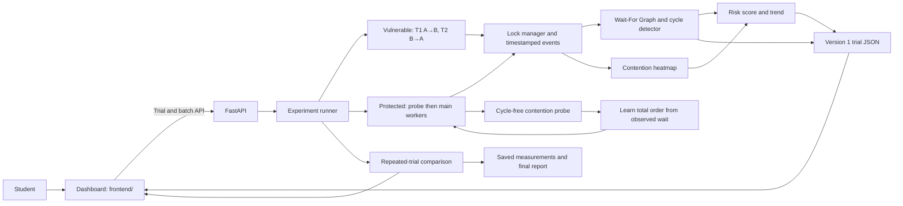

# Predictive Deadlock Lab - implemented architecture

The browser dashboard is backed by FastAPI locally or on the integrated Vercel deployment. Python threads and mutexes perform the Operating Systems experiment. The separate legacy static preview can replay data and import JSON, but does not run Python.



## Vulnerable path

```mermaid
sequenceDiagram
  participant T1
  participant T2
  participant M as Lock manager
  participant A as Analyzer
  T1->>M: acquire A
  T2->>M: acquire B
  T1->>M: request B; wait for T2
  M->>A: owners A=T1, B=T2; waits T1=B
  A-->>A: structural risk warning, no cycle yet
  Note over T1,T2: controlled 120 ms observation interval
  T2->>M: request A; wait for T1
  M->>A: waits T1=B, T2=A
  A-->>A: WFG cycle T1→T2→T1
  M-->>T1: bounded wait expires; cleanup
  M-->>T2: bounded wait expires; cleanup
```

## Protected path

```mermaid
sequenceDiagram
  participant T1
  participant T2
  participant M as Lock manager
  participant P as Adaptive policy
  T1->>M: probe: acquire A, request B
  T2->>M: probe: acquire B
  M->>P: one observed cross-resource wait; no cycle
  P-->>P: derive total order A→B
  P->>T2: release probe lock before requesting A
  Note over T1,T2: probe ends with all locks released
  T1->>M: main work: acquire A then B
  T2->>M: main work: requested B,A normalized to A,B
  M-->>T1: complete and release
  M-->>T2: complete and release
```

## Contracts and failure handling

Each raw event records monotonic elapsed time, thread, action, resource, owner, and observed wait. The trial converter reconstructs full `owners` and `waits` snapshots, calculates a time-local score, and validates the version 1 frontend contract. A warning is a heuristic; only a WFG cycle confirms deadlock. Timeout/error results are returned as failures rather than successful trials. Lock waits and the supervisor monitor are bounded, though trials share the local FastAPI process rather than isolated worker processes.

The browser validates trial JSON before rendering the timeline, graph, score, heatmap, comparison cards, or CSV export. Batch statistics stay separate from individual loaded trial cards. `scripts/collect_results.py` saves the measured comparison and representative importable trials under `docs/`.
