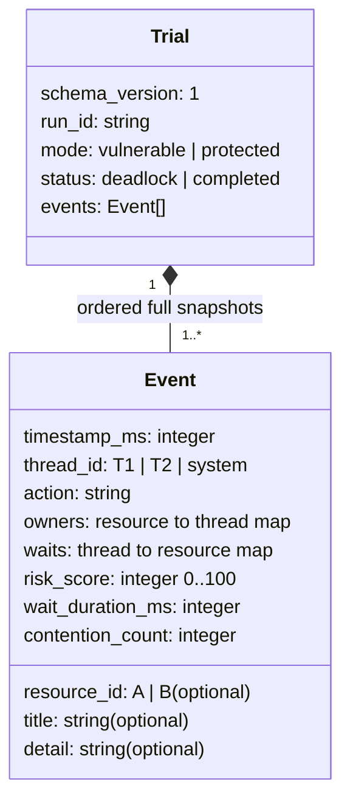

# Predictive Deadlock Lab — detailed architecture

**Updated:** 12 October 2026  
**Project:** Predictive Deadlock Prevention Using Contention Analysis and Score Forecasting  
**Legend:** Blue = implemented frontend; amber = planned experiment/analysis; gray = optional later integration. The arrows show data or control flow, not shared memory between the browser and native threads.

## 1. End-to-end system architecture

```mermaid
flowchart LR
    U["Student / evaluator"]

    subgraph EXP["A. OS experiment runner — planned"]
        direction TB
        CLI["CLI trial controller<br/>mode, run id, timeout, seed"]
        SUP["Supervisor process<br/>launch, monitor, terminate child"]
        CHILD["Isolated worker process"]
        BAR["Start barrier / controlled interleaving"]
        T1["Real thread T1"]
        T2["Real thread T2"]
        LA["Mutex A"]
        LB["Mutex B"]
        POLICY["Lock acquisition policy<br/>vulnerable: opposite order<br/>protected: common A then B order"]
        REC["Instrumentation<br/>request, acquire, wait, release"]
        CLOCK["Monotonic clock<br/>milliseconds since trial start"]

        CLI --> SUP --> CHILD
        CHILD --> BAR
        CHILD --> POLICY
        BAR --> T1
        BAR --> T2
        POLICY --> T1
        POLICY --> T2
        T1 <--> LA
        T1 <--> LB
        T2 <--> LA
        T2 <--> LB
        T1 --> REC
        T2 --> REC
        LA --> REC
        LB --> REC
        CLOCK --> REC
        SUP -. "timeout / cycle: stop stuck child" .-> CHILD
    end

    subgraph ANA["B. Online analysis and trial output — planned"]
        direction TB
        EV["Ordered instrumented events"]
        STATE["State snapshot builder<br/>owners A/B; waits T1/T2"]
        WFG["Wait-For Graph builder<br/>T1 to T2; T2 to T1"]
        CYCLE["Cycle detector<br/>confirmed deadlock"]
        MET["Contention metrics<br/>wait duration, conflict count"]
        SCORE["Time-local risk score 0–100<br/>forecast / warning rule"]
        TERM["Terminal outcome<br/>deadlock_detected or complete"]
        SERIAL["Version 1 trial serializer<br/>full snapshot per action"]
        SCHEMA["Trial JSON Schema + examples"]
        JSON["One JSON file per trial"]

        EV --> STATE
        STATE --> WFG --> CYCLE
        STATE --> MET
        MET --> SCORE
        WFG --> SCORE
        CYCLE --> TERM
        SCORE --> SERIAL
        MET --> SERIAL
        STATE --> SERIAL
        TERM --> SERIAL
        SCHEMA --> SERIAL
        SERIAL --> JSON
    end

    subgraph UI["C. Static website — implemented"]
        direction TB
        INPUT["Import trial JSON file<br/>or built-in demo selection"]
        VALID["trial-data.js<br/>validate + normalize contract"]
        MODEL["app.js<br/>frames, step/play/pause/reset"]
        GRAPH["Wait-For Graph view"]
        TIME["Event timeline"]
        RISK["Risk trend + warning marker"]
        HEAT["A/B contention heatmap"]
        STATS["Metrics and two-run comparison"]
        CSV["CSV export"]
        PAGE["Responsive HTML/CSS dashboard"]

        INPUT --> VALID --> MODEL
        MODEL --> GRAPH
        MODEL --> TIME
        MODEL --> RISK
        MODEL --> HEAT
        MODEL --> STATS
        MODEL --> CSV
        GRAPH --> PAGE
        TIME --> PAGE
        RISK --> PAGE
        HEAT --> PAGE
        STATS --> PAGE
    end

    subgraph EVAL["D. Repeated-trial evaluation — planned"]
        direction TB
        BATCH["Batch trials<br/>multiple vulnerable/protected runs"]
        AGG["Aggregate results<br/>deadlock rate, completion rate,<br/>warning lead time, wait and contention"]
        REPORT["Measured tables, plots, limitations<br/>for final report/presentation"]
        BATCH --> AGG --> REPORT
    end

    subgraph FUTURE["E. Optional live website execution — later"]
        direction TB
        API["API / job endpoint"]
        JOB["Async trial job + status"]
        FETCH["Fetch completed version 1 JSON"]
        API --> JOB --> FETCH
    end

    U -->|choose and run trials locally| CLI
    REC --> EV
    CYCLE -->|signal confirmed cycle| SUP
    JSON -->|manual file import: working integration boundary| INPUT
    JSON --> BATCH
    U -->|operate website| PAGE
    PAGE -->|select demo or file| INPUT
    U -. "optional browser Run action" .-> API
    JOB -. "launch isolated trial" .-> SUP
    FETCH -. "loadTrial(trial)" .-> VALID
    JSON -. "API returns same schema" .-> FETCH

    classDef built fill:#dbeafe,stroke:#2563eb,color:#172554,stroke-width:2px;
    classDef planned fill:#fef3c7,stroke:#d97706,color:#78350f,stroke-width:2px;
    classDef optional fill:#e5e7eb,stroke:#6b7280,color:#111827,stroke-dasharray:5 4;
    class INPUT,VALID,MODEL,GRAPH,TIME,RISK,HEAT,STATS,CSV,PAGE built;
    class CLI,SUP,CHILD,BAR,T1,T2,LA,LB,POLICY,REC,CLOCK,EV,STATE,WFG,CYCLE,MET,SCORE,TERM,SERIAL,JSON,BATCH,AGG,REPORT planned;
    class API,JOB,FETCH optional;
```



### Key boundaries

1. **OS boundary:** The browser cannot run the native mutex experiment. A CLI runner is the immediate next deliverable. Its worker process must be isolated so intentional deadlocks can be observed and terminated safely.
2. **Observation boundary:** Workers report attempts, successful acquisitions, waits, and releases. A state builder creates a complete `owners` and `waits` snapshot after each event. Use a monotonic clock for timestamps.
3. **Analysis boundary:** A `waits` entry plus the owner of that lock creates a Wait-For Graph edge. A cycle is the deadlock result for this controlled two-thread, single-instance-mutex case. The score is an early warning; it is not the cycle detector.
4. **Integration boundary:** The version 1 JSON trial is the interface between the real experiment and the frontend. One file contains one trial with ordered full-state events. The website already validates and imports it.
5. **Presentation boundary:** Demo data is illustrative. Evaluation tables and claims must come from repeatable measured trials, with the scoring rule documented.

## 2. Trial lifecycle and failure handling

```mermaid
sequenceDiagram
    autonumber
    actor User as Student
    participant CLI as Trial controller
    participant Child as Isolated worker process
    participant T1 as Thread T1
    participant T2 as Thread T2
    participant Obs as Event observer / analyzer
    participant File as Trial JSON file
    participant Web as Website importer

    User->>CLI: Start trial(mode, run_id, timeout)
    CLI->>Child: Launch isolated worker
    Child->>T1: Start at barrier
    Child->>T2: Start at barrier
    Child->>Obs: Emit start snapshot at 0 ms

    alt Vulnerable mode
        T1->>Obs: Acquires A; owners A=T1
        T2->>Obs: Acquires B; owners B=T2
        T1->>Obs: Requests B; waits T1=B
        T2->>Obs: Requests A; waits T2=A
        Obs->>Obs: Build T1 to T2 and T2 to T1 edges
        Obs-->>CLI: Confirm cycle / deadlock
        CLI->>Child: Terminate deadlocked worker safely
        CLI->>File: Write deadlock_detected terminal snapshot
    else Protected mode
        T1->>Obs: Acquires A then B in common order
        T2->>Obs: Waits if A is held; no circular wait
        T1->>Obs: Releases B then A
        T2->>Obs: Acquires A then B; releases both
        Obs-->>CLI: Both threads completed
        CLI->>File: Write complete terminal snapshot, no owners/waits
    end

    opt Worker stalls without expected terminal event
        CLI->>Child: Enforce timeout and terminate worker
        CLI->>File: Preserve diagnostic outcome separately
        Note over CLI,File: Do not label an arbitrary timeout as a confirmed deadlock
    end

    User->>Web: Import completed trial JSON
    Web->>Web: Validate schema, timestamps, states and outcome
    Web->>User: Replay graph, risk, heatmap, metrics and comparison
```

## 3. Version 1 trial data shape



See [`frontend/contract/README.md`](frontend/contract/README.md), [`trial-v1.schema.json`](frontend/contract/trial-v1.schema.json), and the two example JSON files for exact validation rules. The frontend initially supports exactly `T1`, `T2`, `A`, and `B`. Its demo warning threshold is 70; the real scoring formula and warning calibration still need to be defined and evaluated.

## 4. Team implementation ownership

| Order | Owner | Architecture components |
| --- | --- | --- |
| 1 | Midhun Gereketi | Static dashboard, JSON contract, importer, visualizations, comparison, integration verification. This portion is implemented. |
| 2 | P. Satya Mani Shraavanth | CLI controller, isolated worker, real threads and mutexes, vulnerable/protected policies, instrumentation, timeout handling, JSON generation. |
| 3 | M. Lakshman Sai | Snapshot analysis, Wait-For Graph and cycle detection, contention measures, risk score/forecast, repeated-trial evaluation. |

**First integration milestone:** Shraavanth produces one real trial JSON per mode, Lakshman enriches those trials with computed analysis fields, and Midhun imports both into the existing website. The optional API should be considered only after the CLI-to-JSON-to-website path works end to end.

