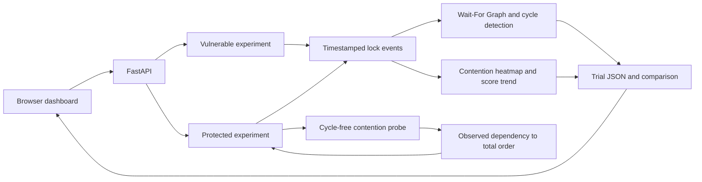

# Predictive Deadlock Prevention Using Contention Analysis and Score Forecasting

**Operating Systems case study experiment**

**Team:** Midhun Gereketi (frontend and integration), P. Satya Mani Shraavanth (threaded experiment and API), M. Lakshman Sai (analysis and evaluation)

**Implementation:** Python threaded experiment, FastAPI, and a browser dashboard

## Abstract

This project demonstrates a controlled two-thread, two-mutex circular wait and a preventive lock-order policy. The vulnerable run makes T1 acquire A then request B, while T2 acquires B then requests A. A Wait-For Graph confirms the cycle. The analysis records ownership, waits, contention, a 0–100 risk score, and warning timing from events observed so far. In the protected run, a short probe creates a single cross-resource wait without allowing a cycle. The system raises a structural warning, derives one total order from the observed dependency, and applies that order to both workers before they acquire their main-work locks. A web dashboard shows the graph, score trend, heatmap, timeline, and comparison. In the saved 10-trial-per-mode experiment, all 10 vulnerable runs deadlocked and all 10 protected runs completed. These are controlled demonstration results, not a claim about arbitrary workloads.

## 1. Problem and objectives

Opposite lock acquisition orders can create circular wait, one of the necessary deadlock conditions. The objective is to detect an actual cycle, identify risk before the cycle in a staged schedule, and demonstrate how a common lock order removes circular wait without stopping thread progress. The implementation also makes its measurements inspectable through trial JSON and a repeatable comparison command.

## 2. System design

The browser can replay built-in examples or import a trial JSON file. When served by FastAPI locally at `http://127.0.0.1:8000/` or at `https://predictive-deadlock-lab.vercel.app/`, it can call live trial and batch APIs. The separate static preview contains no Python runtime and therefore supports demo and file import only.

### Modules

| Case study module | Implementation |
| --- | --- |
| Vulnerable baseline and attack scenario | `member2_backend/vulnerable_experiment.py` stages T1: A → B and T2: B → A with real Python threads and mutexes. |
| Contention analysis and detection | `member2_backend/lock_manager.py` tracks owners/waiters; `member3_analysis/graph.py` builds WFG edges and checks cycles. |
| Heatmap | `member3_analysis/heatmap.py` counts observed resource-pair conflicts and waits. |
| Score and forecast | `member3_analysis/threat_scorer.py` combines blocked threads, waiting time, contention, and resource state. `trend_analyzer.py` records score changes. |
| Adaptive prevention | `member2_backend/adaptive_policy.py` derives a total order from the probe's observed held-resource → requested-resource dependency; `protected_experiment.py` applies it to both workers. |
| Evaluation | `member3_analysis/comparator.py` computes measured per-trial and aggregate results; `scripts/collect_results.py` saves reproducible data. |
| Visualization | `frontend/` shows graph, timeline, score, heatmap, and comparison. |

## 3. Algorithms and measurements

**Wait-For Graph:** A directed edge Tᵢ → Tⱼ exists only when Tᵢ is waiting for a lock currently owned by Tⱼ. A cycle T1 → T2 → T1 confirms deadlock for these single-instance locks. A `deadlock_detected` notification does not itself create graph edges.

**Score:** The base score is a weighted sum of normalized blocked-thread count (0.35), peak wait duration (0.30), contention count (0.20), and resource conflict state (0.15). The default high threshold is 70. In this two-lock experiment, if distinct workers hold A and B and one is waiting for the other's lock, the structural rule raises the score to at least 72 before a cycle exists. This rule uses only the current snapshot. It is a heuristic risk indicator, not proof of a future deadlock. A detected cycle is labelled separately as confirmed deadlock.

**Adaptive policy:** The protected run first creates one observed dependency with T1 holding A, T2 holding B, and T1 waiting for B. Before T2 can request A, the policy derives A → B from the held/requested pair. The probe releases B, so no circular wait forms. Both main workers then normalize their requested lock lists to the derived total order before acquiring any lock. An alternate observed dependency B → A would derive B → A; the policy unit test covers both directions. A common total order rules out a circular wait between these two locks.

**Measurements:** Deadlock rate = confirmed-cycle trials / all trials. Completion rate = both-workers-completed trials / all trials. Warning lead = first pre-cycle high-score timestamp to first observed cycle timestamp. Detection latency = first cycle timestamp to supervisor notification timestamp. Runtime is measured from the start of each experiment, including the protected probe. Failed runs are counted as inconclusive rather than silently counted as success. Times are millisecond-resolution observations and can vary with machine load.

The dashboard's vulnerable trial timeline ends at the deadlock notification. The comparison's full trial runtime also includes the bounded wait and worker cleanup afterward; these are different clocks and should not be compared as if they were the same metric.

## 4. Experimental protocol and results

Run `python scripts/collect_results.py --trials 10` from the repository root after installing dependencies. The script writes `docs/results.json` plus one importable sample JSON per mode. Every trial uses two logical worker roles and single-instance mutexes A and B. Vulnerable runs include a controlled 120 ms observation interval between the first wait and the conflicting second request. Each trial is capped by bounded lock waits and a 3-second comparison timeout. The protected run includes a cycle-free probe and main workers in the same measured timeline.

The checked-in measurement set in `results.json` was collected on Windows with Python; its timestamp and exact runtime environment are in that file.

| Metric | Vulnerable | Protected |
| --- | ---: | ---: |
| Trials | 10 | 10 |
| Confirmed deadlocks | 10 | 0 |
| Completed trials | 0 | 10 |
| Inconclusive trials | 0 | 0 |
| Deadlock rate | 100% | 0% |
| Mean runtime, including probe where applicable | 813.6 ms | 104.6 ms |
| Mean peak wait | 809.0 ms | 28.9 ms |
| Mean peak threat score | 96 | 72 |
| Mean warning lead before cycle | 120.4 ms | Not applicable |
| Mean cycle detection latency | 4.6 ms | Not applicable |

Protected runs still reach the warning score during the probe. That is expected: the policy is activated in response to the observed risk, after which the main workers complete. The protected score of 72 therefore does not indicate a protected deadlock.

## 5. Interpretation and limitations

The controlled schedule made the vulnerable cycle reproducible and gave the observer an intentional 120 ms interval in which to report risk. The observed warning lead must not be presented as general predictive accuracy. The protected order is derived from a calibration dependency and applied to the subsequent main phase; the system does not rearrange locks already held by a running worker. The experiment contains only two threads and two single-instance mutexes, uses Python scheduling on one machine, and does not measure throughput under a larger workload. The in-process supervisor and finite lock waits keep ordinary runs bounded, but this is a teaching prototype rather than a process-isolated production service.

The saved sample is one measurement set. Running the collection command again creates a new set; timing values may differ. The code and tests distinguish actual graph cycles from warnings, reject malformed completed trials, and report inconclusive trials separately.

## 6. Reproduction and demonstration

1. `pip install -r member2_backend/requirements.txt`
2. `python -m pytest member2_backend/tests member3_analysis/tests -q`
3. `node --test frontend/tests/trial-data.test.js`
4. `python -m uvicorn member2_backend.api:app --host 127.0.0.1 --port 8000`
5. Open `http://127.0.0.1:8000/`, run one live trial in each mode, then run the five-each batch comparison.
6. For the saved 10-each evaluation, run `python scripts/collect_results.py --trials 10`; import either `docs/sample-*.json` in the browser.

See `docs/DEMO_AND_PRESENTATION.md` for a short demonstration and slide sequence.
