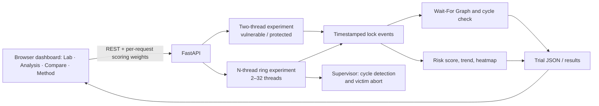

# Predictive Deadlock Prevention Using Contention Analysis and Score Forecasting

**Operating Systems case study experiment (BCSE303L)**

**Team:** Midhun Gereketi (frontend, visualisation and integration) · P. Satya Mani Shraavanth (threaded experiments and API) · M. Lakshman Sai (analysis, scoring and evaluation)

**Implementation:** Python threads and mutexes, FastAPI, and a browser dashboard. Live at <https://predictive-deadlock-lab.vercel.app/>; source at <https://github.com/midhungereketi/predictive-deadlock-lab>.

## Abstract

The project builds controlled deadlocks with real operating-system threads and studies how to observe, warn about and prevent them. The **original two-thread experiment** makes T1 take lock A then B while T2 takes B then A; a Wait-For Graph (WFG) confirms the resulting cycle, and a weighted 0–100 risk score raises an early warning before the cycle appears. Its **protected mode** learns one global lock order from a cycle-free probe and applies it before the workers start. A second, **configurable N-thread ring** (2–32 threads on N locks) forms one cycle through every thread; a supervisor detects it and **recovers by aborting a victim thread**, while protected mode uses a global lock order and always completes. The dashboard **replays** each run step by step, and its **Analysis** and **Compare** views show why the score warned, how early, and how the two modes differ over repeated trials and thread counts.

In the saved 10-trials-per-mode measurement (15 October 2026) all 10 vulnerable two-thread runs deadlocked and all 10 protected runs completed. A new collection on 26 October 2026 reproduced this (10/10 and 10/10) and added a scaling study: across 2, 4, 8, 16 and 32 threads (10 trials per size and mode) every vulnerable run formed a cycle through all N threads and recovered with exactly one aborted thread, and every protected run completed all threads. **The warning is a documented heuristic evaluated in a controlled experiment; the project does not claim to predict deadlocks in arbitrary programs.**

## 1. Problem and objectives

A deadlock needs four conditions at once: mutual exclusion, hold-and-wait, no preemption and circular wait. Opposite lock acquisition orders make circular wait possible. The objectives are to:

1. reproduce circular wait deterministically with real threads and single-instance mutexes;
2. **detect** an actual cycle from observed ownership and wait events;
3. **warn** before the cycle using only information available at that moment, and measure how early;
4. **prevent** circular wait with a common lock order, and **recover** from it by preempting a victim;
5. make every measurement inspectable (event logs, JSON, CSV) and repeatable.

## 2. Architecture



The FastAPI app also serves the dashboard, so the same code runs locally (`uvicorn`) and on Vercel (`app.py`). The server keeps **no mutable state between requests**: each request runs its own bounded experiment and builds its own scorer.

| Component | Implementation |
| --- | --- |
| Two-thread vulnerable/protected experiments | `member2_backend/vulnerable_experiment.py`, `protected_experiment.py`, `adaptive_policy.py`, `experiment_runner.py` |
| Lock tracking, bounded and cancellable waits, cycle detection | `member2_backend/lock_manager.py` |
| N-thread ring with supervisor and victim recovery | `member2_backend/multi_thread_experiment.py` |
| Event log (high-resolution clock) | `member2_backend/event_logger.py` |
| WFG, heatmap, risk score, trend, comparison | `member3_analysis/graph.py`, `heatmap.py`, `threat_scorer.py`, `trend_analyzer.py`, `comparator.py` |
| Request-scoped analysis API | `member3_analysis/api_routes.py` |
| Dashboard, replay, Analysis and Compare views | `frontend/index.html`, `app.js`, `styles.css`, `motion.js` |
| Shared scoring formula for the browser | `frontend/scoring.js` (checked against `shared/scoring_cases.json`) |

## 3. Algorithms

### 3.1 Wait-For Graph and cycle detection

An edge Tᵢ → Tⱼ exists only while Tᵢ waits for a lock currently owned by Tⱼ. Because every thread waits for at most one lock, each node has at most one outgoing edge, so the graph is a functional graph: following edges from each unvisited node and stopping at a repeated node finds any cycle in linear time. For single-instance locks a cycle is a confirmed deadlock. A `deadlock_detected` notification never creates edges by itself.

### 3.2 Risk score (early-warning heuristic)

```
Score = round_half_up(w_b·B + w_w·W + w_c·C + w_r·R)
  B = blocked threads / 2 × 100        W = longest wait / 800 ms × 100 (capped at 100)
  C = contention events / 5 × 100       R = 100 if A and B are held by different threads,
                                            40 if one thread holds both, 20 if one lock is held, else 0
Defaults: w_b 0.35, w_w 0.30, w_c 0.20, w_r 0.15 (sum 1.00); warning threshold 70.
```

Two documented rules apply: if different threads hold A and B and one of them is waiting, the score is raised to at least 72 (lock-order inversion), and a confirmed cycle sets it to at least 96. The score uses only the current snapshot, so it never looks into the future. It is labelled separately from a confirmed cycle. **Weights are request-scoped:** a visitor can change them in the Analysis view, where they are applied immediately in the browser and sent with each backend request that visitor starts; they are stored only in that browser (optional "Save in this browser"), never on the server, so one visitor cannot change another's results. Python (`threat_scorer.py`) and the browser (`scoring.js`) both round half up and are tested against the same ten shared cases.

### 3.3 Adaptive protected policy (two threads)

A short probe lets T1 hold A while waiting for B held by T2, then stops before T2 requests A, so no cycle forms. The policy derives the total order A → B from the observed held → requested pair; both main workers sort their lock requests into this order before taking any lock. With one global order no thread can hold B while waiting for A, so circular wait cannot occur.

### 3.4 N-thread ring with victim recovery

Thread Tᵢ needs locks Rᵢ and R₍ᵢ mod N₎₊₁ (the dining-philosophers arrangement).

* **Vulnerable:** every thread takes its own lock, all threads meet at a barrier, then each requests the next lock. Every thread now waits for its neighbour, so the WFG is one cycle through all N threads. A supervisor polls a consistent snapshot of owners and waits every millisecond, detects the cycle, and **recovers by aborting the highest-numbered thread**: its blocked acquire is cancelled, it releases its lock, and the remaining threads finish one after another. Lock waits are bounded by the run timeout in every case.
* **Protected:** each thread takes its lower-numbered lock first. The last thread therefore requests R₁ before R_N, which breaks circular wait; threads only queue behind neighbours and all complete.

### 3.5 Replay and views

Each run's event log is replayed as an animation: lock tiles move to the thread that takes them, wait arrows appear, the deadlock moment flashes and recovery unwinds. The **Analysis** view re-scores a run with the current weights and reports peak score, first warning, deadlock time, warning lead time, longest wait and contention, with a per-event factor breakdown. The **Compare** view runs both modes, repeated trials, and the N-thread scaling test, and exports CSV.

## 4. Workflow

1. **Lab:** run the two-thread live trial (vulnerable or protected) or an N-thread ring; watch the replay.
2. **Analysis:** inspect when the warning fired and why; tune weights and see the run re-scored.
3. **Compare:** run both modes side by side, repeated two-thread trials (rates), and the scaling test (2–32 threads, repeated, with spread).
4. **Export:** download event logs and results as CSV; the backend can also be scripted (`scripts/collect_results.py`, `scripts/collect_scaling_results.py`).

## 5. Evaluation protocol

**Two-thread:** `python scripts/collect_results.py --trials 10` runs 10 vulnerable and 10 protected trials (3 s cap each). Deadlock rate = confirmed-cycle trials / trials; completion rate = trials where both workers finished / trials; warning lead = first pre-cycle score ≥ threshold to first observed cycle; detection latency = first cycle to supervisor notification; runtime includes the protected probe. Failed runs count as inconclusive, never as success. Vulnerable runs contain a deliberate 120 ms observation interval between the first wait and the conflicting request.

**Scaling:** `python scripts/collect_scaling_results.py --sizes 2 4 8 16 32 --trials 10 --output …` runs the ring 10 times per size per mode, alternating modes. Vulnerable runtime means *start → detection → victim abort → all other threads finished*; protected runtime means *start → every thread completed*. Every raw run is saved with the summary.

## 6. Results

### 6.1 Saved measurement set (collected 15 October 2026, `docs/results.json`)

| Metric | Vulnerable | Protected |
| --- | ---: | ---: |
| Trials | 10 | 10 |
| Confirmed deadlocks | 10 | 0 |
| Completed | 0 | 10 |
| Inconclusive | 0 | 0 |
| Mean runtime | 813.6 ms | 104.6 ms |
| Mean peak wait | 809.0 ms | 28.9 ms |
| Mean peak score | 96 | 72 |
| Mean warning lead before cycle | 120.4 ms | n/a |
| Mean detection latency | 4.6 ms | n/a |

### 6.2 New measurement set (collected 26 October 2026 IST, 25 Oct 19:22 UTC)

Two-thread re-run (`docs/results_2026-10-26_two_thread.json`, Windows 11, Python 3.12.14):

| Metric | Vulnerable | Protected |
| --- | ---: | ---: |
| Trials | 10 | 10 |
| Confirmed deadlocks / completed / inconclusive | 10 / 0 / 0 | 0 / 10 / 0 |
| Mean runtime | 813.4 ms | 103.9 ms |
| Mean peak wait | 808.4 ms | 29.4 ms |
| Mean peak score | 96 | 72 |
| Mean warning lead before cycle | 121.6 ms | n/a |
| Mean detection latency | 3.1 ms | n/a |

N-thread scaling (`docs/results_2026-10-26_scaling.json`, 10 trials per size and mode):

| Threads | Vulnerable deadlocked | Cycle through all threads | Recovered (1 aborted) | Detection, mean (max) | Detection + recovery time, mean ± sd [min–max] | Protected completed | Completion time, mean ± sd [min–max] | Peak queued (mean) |
| ---: | ---: | ---: | ---: | ---: | ---: | ---: | ---: | ---: |
| 2 | 10/10 | 10 | 10 | 1.81 (2.51) ms | 45.4 ± 2.6 [39–49] ms | 10/10 | 61.9 ± 0.9 [61–63] ms | 1.0 |
| 4 | 10/10 | 10 | 10 | 1.97 (2.19) ms | 107.2 ± 2.0 [105–111] ms | 10/10 | 68.6 ± 19.1 [61–123] ms | 2.1 |
| 8 | 10/10 | 10 | 10 | 2.49 (3.04) ms | 229.4 ± 2.7 [226–236] ms | 10/10 | 93.9 ± 24.9 [63–124] ms | 4.8 |
| 16 | 10/10 | 10 | 10 | 4.20 (6.50) ms | 473.0 ± 4.5 [468–480] ms | 10/10 | 92.3 ± 17.1 [64–125] ms | 8.9 |
| 32 | 10/10 | 10 | 10 | 6.65 (8.00) ms | 967.8 ± 3.6 [964–975] ms | 10/10 | 95.6 ± 9.1 [70–100] ms | 17.4 |

The two sets agree on every outcome. Small times are not directly comparable between them: the saved set used `time.monotonic`, which ticks about every 15.6 ms on Windows, while the new set uses `time.perf_counter`; detection latency (4.6 ms vs 3.1 ms) is the most affected. The score's rounding also changed from Python's banker's rounding to round-half-up; peak scores are fixed by the 72/96 rules and are unaffected.

**Reading the scaling results.** Detection stays within a few milliseconds; it grows with N, likely because more threads must reach the barrier and register their waits before the cycle is complete. Vulnerable time grows almost linearly, about 30 ms per extra thread, because after the victim is aborted the remaining threads finish one after another, each holding both locks for 30 ms. Protected time stays roughly flat because non-neighbouring threads run in parallel; its larger spread at 4–16 threads reflects scheduling order in the queues. Protected runs at the same size consistently queued about half the threads at their busiest moment.

## 7. Interpretation and limitations

* The schedules are controlled: barriers and a 120 ms interval make the cycle reproducible and give the warning time to fire. The measured lead time describes this experiment only; it is **not** a measure of predictive accuracy for other programs.
* The two-thread policy learns its order from a calibration probe before the workers start; it does not reorder locks a running thread already holds. The ring's victim policy (highest-numbered thread) is simple and ignores fairness and rollback cost.
* Python threads run under the global interpreter lock, on one machine; timings vary with load and are not a performance benchmark.
* The score has fixed normalisation ceilings (2 threads, 800 ms, 5 events) designed for the two-thread case; it is not calibrated for the N-thread ring.
* Runs are bounded by timeouts and an in-process supervisor; this is a teaching prototype, not a process-isolated production service. On Vercel each request runs independently; user settings live in the visitor's browser.

## 8. Literature review (2020–2025)

| Work | Contribution | Relation to this project |
| --- | --- | --- |
| Qin et al., *Understanding Memory and Thread Safety Practices and Issues in Real-World Rust Programs*, PLDI 2020 [1] | Studies 170 real bugs in Rust projects, including blocking/deadlock bugs, and builds static detectors. | Shows that lock-order deadlocks persist even in a memory-safe language, motivating explicit lock ordering. |
| Cai, Meng & Palsberg, *Low-Overhead Deadlock Prediction*, ICSE 2020 [2] | AirLock keeps a small lock reachability graph and searches it for cycles, reporting about 3.5 % average overhead. | Our supervisor also searches a small graph for cycles; we confirm cycles at runtime instead of predicting them from traces. |
| Liu et al., *Automatically Detecting and Fixing Concurrency Bugs in Go Software Systems*, ASPLOS 2021 [3] | GCatch finds blocking bugs with a constraint solver; GFix patches many of them automatically. | Detection followed by repair parallels our detect-then-recover ring, although our recovery is runtime preemption rather than a code fix. |
| Tunç, Mathur, Pavlogiannis & Viswanathan, *Sound Dynamic Deadlock Prediction in Linear Time*, PLDI 2023 [4] | Proves sound and complete prediction intractable in general and gives linear-time algorithms (SPDOffline/SPDOnline) for sync-preserving deadlocks. | Explains why our score is presented as a heuristic warning, not a sound predictor. |
| Qin et al., *Understanding and Detecting Real-World Safety Issues in Rust*, IEEE TSE 2024 [5] | Studies 70 memory bugs, 100 concurrency bugs and 110 panic-causing errors, and implements five static detectors; the artifact (lockbud) includes a blocking/deadlock detector. | Supports lock-order analysis as a practical prevention strategy, as in our protected modes. |
| van den Heuvel, Sulzmann & Thiemann, *Partial Orders for Precise and Efficient Dynamic Deadlock Prediction*, arXiv preprint 2025 [6] | Uses partial orders over a trace to filter false-positive deadlock patterns. | Highlights the false-positive problem that a heuristic warning, like ours, must report honestly (our "false alarm" verdict). |

## 9. Testing

* **Python (`member2_backend/tests`, `member3_analysis/tests`):** experiments, timeouts, events, API, analysis, the ring (2, 5, 12 and 32 threads), shared-case scoring consistency, and scoring isolation (sequential, concurrent and real-trial checks that one visitor's weights never change another's results).
* **Node (`frontend/tests`):** trial contract checks and browser scoring against the shared cases.
* **Browser (`tests/e2e`, Playwright with a real server):** tab switching, live weight tuning and its saved/temporary states, per-visitor privacy of weights including backend scores, running both modes, repeated trials, scaling, injected backend failures, and CSV exports.

## 10. Team roles

* **Midhun Gereketi:** dashboard, replay and visualisation, Analysis and Compare views, trial contract, integration, deployment and documentation.
* **P. Satya Mani Shraavanth:** threaded experiments, lock manager, protected policy, N-thread ring and recovery, REST API.
* **M. Lakshman Sai:** Wait-For Graph, risk score, trend and heatmap analysis, repeated-trial comparison and evaluation.

## 11. Reproduction

```
pip install -r requirements-dev.txt
python -m pytest member2_backend/tests member3_analysis/tests tests/e2e
node --test frontend/tests/trial-data.test.js frontend/tests/scoring.test.js
python -m uvicorn member2_backend.api:app --host 127.0.0.1 --port 8000
python scripts/collect_results.py --trials 10 --output docs/<new>.json --skip-samples
python scripts/collect_scaling_results.py --sizes 2 4 8 16 32 --trials 10 --output docs/<new>.json
```

## References

1. B. Qin, Y. Chen, Z. Yu, L. Song and Y. Zhang. Understanding Memory and Thread Safety Practices and Issues in Real-World Rust Programs. PLDI 2020. <https://pldi20.sigplan.org/details/pldi-2020-papers/76/Understanding-Memory-and-Thread-Safety-Practices-and-Issues-in-Real-World-Rust-Progra>
2. Y. Cai, R. Meng and J. Palsberg. Low-Overhead Deadlock Prediction. ICSE 2020, pp. 1298–1309. doi:10.1145/3377811.3380367
3. Z. Liu, S. Zhu, B. Qin, H. Chen and L. Song. Automatically Detecting and Fixing Concurrency Bugs in Go Software Systems. ASPLOS 2021. <https://github.com/system-pclub/GCatch>
4. H. C. Tunç, U. Mathur, A. Pavlogiannis and M. Viswanathan. Sound Dynamic Deadlock Prediction in Linear Time. PLDI 2023 (Proc. ACM Program. Lang. 7, PLDI, Art. 177). doi:10.1145/3591291
5. B. Qin, Y. Chen, H. Liu, H. Zhang, Q. Wen, L. Song and Y. Zhang. Understanding and Detecting Real-World Safety Issues in Rust. IEEE Transactions on Software Engineering, 2024. doi:10.1109/TSE.2024.3380393
6. B. van den Heuvel, M. Sulzmann and P. Thiemann. Partial Orders for Precise and Efficient Dynamic Deadlock Prediction. arXiv:2502.20070, 2025 (preprint).
